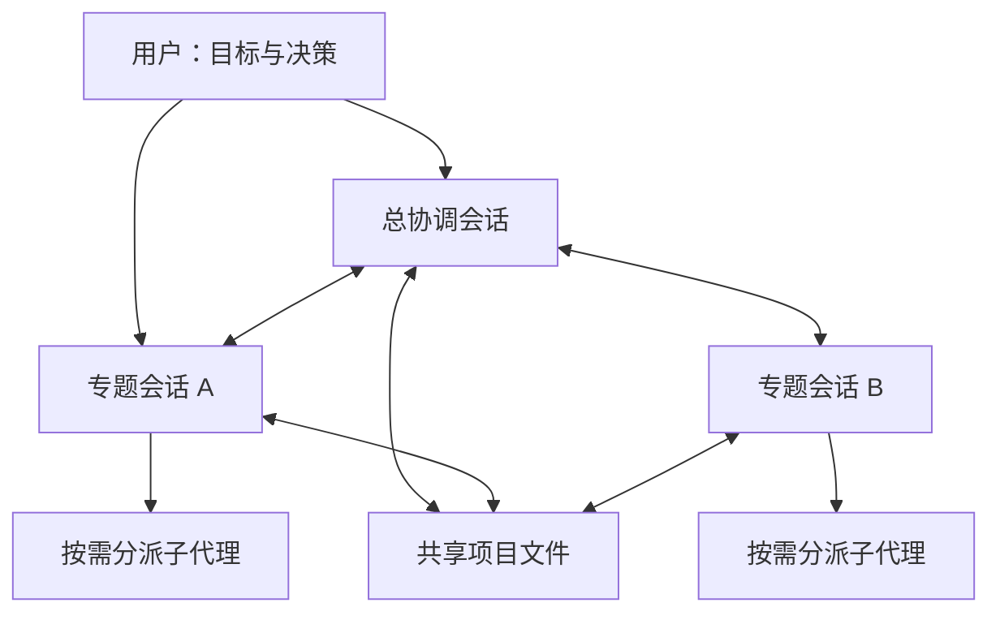

# 多会话、多 Agent 项目协作架构

一套面向长期项目的轻量协作方法：用多个专题会话并行推进，用子代理处理边界明确的任务，用项目文件保存当前决策、进度、证据和恢复断点。

**English:** A practical, file-based pattern for coordinating multiple conversations and subagents on a long-running project. It includes reusable templates and an optional local cooperative single-writer lock.

> 本仓库展示协作模式和本机工具，不包含原项目的会话记录、业务数据、内部路径或凭据。它不是 Codex 内置功能，也不能保证所有 Agent 自动读取或遵守文档。

## 要解决的问题

长项目中，信息会散落在多个会话，方向也可能随着新资料改变。后启动的 Agent 可能不知道先前决定；多个会话同时更新同一份状态又可能互相覆盖。这里将**当前决定、历史证据和动态状态**分开保存，要求恢复工作前重新核对。

## 架构



- **总协调会话**：维护总体方向，协调工作线，验收成果和处理冲突。
- **专题会话**：围绕某一长期问题，在已有授权内自主推进；重要方向变化写入共享基线。
- **子代理**：执行明确范围的阅读、实现或独立复核，将结论和证据位置交还给派单者。
- **共享文件**：保存目标、状态、决策、证据索引和恢复规则；聊天不会自动变成共享事实。
- **后台检查（可选）**：在具备实际调度能力时检查和接续已授权任务；不能代替前提条件、用户确认或真实运行验证。

## 开始使用

1. 将 `templates/AGENTS.md`、`templates/coordination/` 复制到你自己的项目，按实际环境填写占位内容。
2. 在 `coordination/README.md` 和 `DECISIONS.md` 记录目标及用户已确认的决定；在 `STATUS.md` 标记更新时间、在办任务、负责人和证据。
3. 新会话先读项目入口、当前决定和恢复流程，再核查是否已有其他会话在做相同任务。
4. 根据任务复杂度、成本和实际容量选择模型，明确子代理的范围和交付物；关键结果由其他人或其他 Agent 独立复核。
5. 只有当多个本机会话会写同一份共享状态时，才考虑下面的可选锁工具。具体协作流程见 [详细说明](docs/collaboration.md)。

## 可选：本机单写锁

工具使用 Python 标准库，面向 **macOS / Linux 的同机、同用户协作**；所有参与者必须使用同一个私有锁目录，并约定只有持锁的进程才修改受保护文件。

```bash
# 在自己的项目中；用真实物理路径，避免锁路径包含符号链接
LOCK_DIR="$(pwd -P)/.coordination-lock"
mkdir -m 700 "$LOCK_DIR"

# 只读查看状态
python3 scripts/coordination_lock.py --dir "$LOCK_DIR" status

# 取得锁后运行前台写入命令；命令退出后释放
python3 scripts/coordination_lock.py --dir "$LOCK_DIR" run \
  --owner "session-a" --resource "shared-state" --ttl 300 -- \
  python3 -c 'from pathlib import Path; Path("example.txt").write_text("example\\n")'
```

TTL 到期**不会自动释放或抢占锁**。异常中断后先确认原写入者及其子进程已停止，再按[锁使用与恢复](docs/lock.md)执行显式恢复。工具不能阻止绕过它的进程，不能作为权限隔离、跨机器分布式锁、数据库事务或网络文件系统锁保证。

## 验证

```bash
python3 -m unittest discover -s tests -p 'test_*.py' -q
```

测试使用临时目录，覆盖竞争、错误令牌、超时后的显式恢复、信号处理、部分写入、权限与符号链接等。它们不能证明任意系统或生产环境安全；先在目标环境做受控验证。

## 模型与成本

批量、重复性的材料阅读适合交给成本较低的模型；复杂语义、架构判断和关键复核交给更强的模型或主 Agent。模型名称、价格、可用性和并发上限随环境变化，模板不固定具体供应商或型号。

## 项目结构

```text
README.md                      项目介绍与快速开始
docs/collaboration.md          会话、子代理、证据和恢复流程
docs/lock.md                   本机锁的操作与边界
scripts/coordination_lock.py   可选单写锁工具
tests/                         该工具的自动测试
templates/                     可复制的项目规则与协调文件
```

## 许可证

本仓库使用 [GNU Affero General Public License v3.0](LICENSE)。
